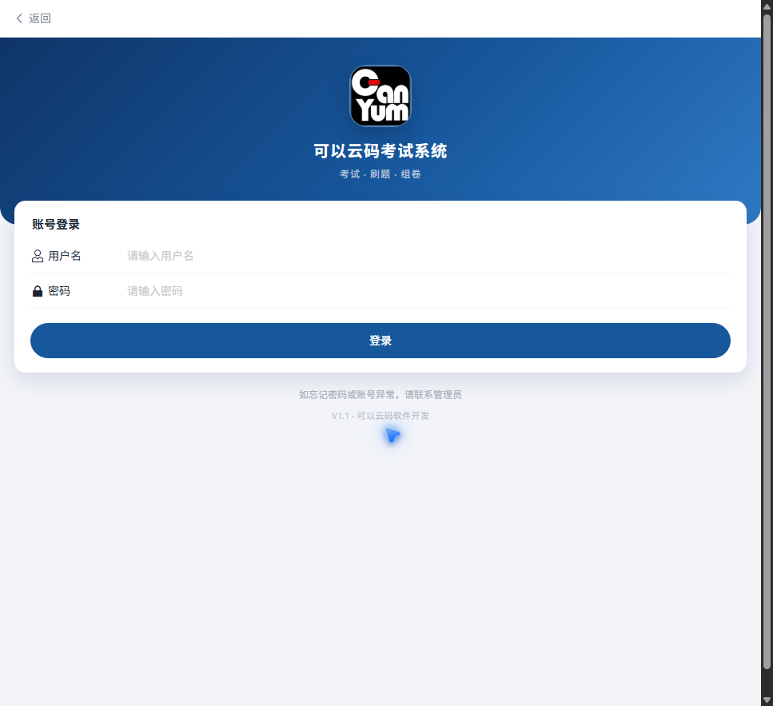
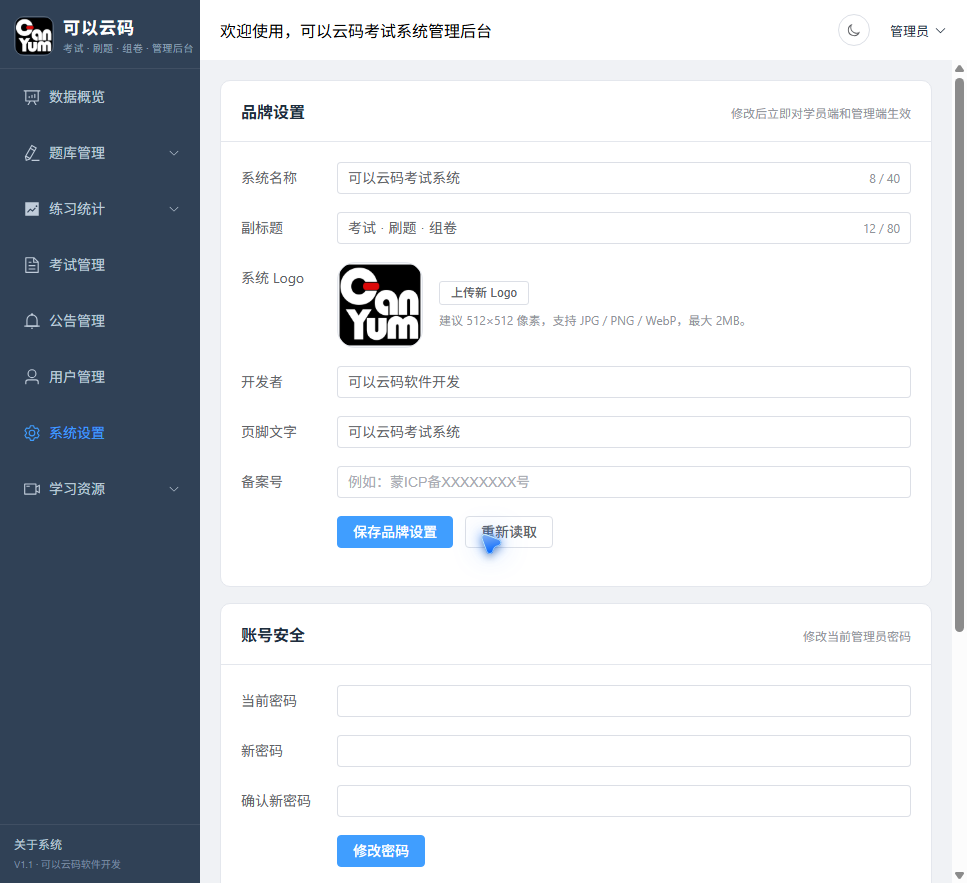

# 可以云码考试系统（CanYum Exam）

一个面向企业 / 行业内部培训与考试场景的前后端分离考试系统：**学员端 H5 + 管理后台 + FastAPI 后端**。支持刷题、错题本、在线考试、学员自主组卷、练习统计、题库批量导入、公告、视频 / 书籍资源和可配置品牌。

> 仓库地址：<https://github.com/dabaibai01/canyum-exam>
>
> 如果这个项目对你有帮助，欢迎点一个 Star，这是对开源作者最直接的鼓励。

[](LICENSE)




## 功能

- **学员端**
  - 账号登录、个人中心、修改密码
  - 顺序刷题：默认从上次位置继续，不从头开始
  - 按分类 / 专业刷题，答题后即时反馈
  - 错题本：待复习 / 已掌握，按日期筛选，超过 10 天自动清理
  - 错题组卷：把错题组成一套卷子，专门攻错题
  - 自己组卷：按题型和数量从题库抽题，自测不受限
  - 在线考试：参加管理员发布的考试，查看成绩
- **管理后台**
  - 数据概览、题库管理、分类管理
  - 批量导入题库（CSV / XLSX，支持单选、多选、判断）
  - 考试管理：创建考试、按题型抽题、查看成绩
  - 练习统计：按日期 / 专业 / 学员查看刷题量、考试量、正确率
  - 公告管理、用户管理、学习资源
  - **系统设置**：修改系统名称、副标题、Logo、开发者、页脚、备案号和登录密码
- **品牌可配置**：名称和 Logo 不写死在页面里，改完立即在学员端和管理端生效。

## 界面预览

| 学员端登录 | 管理端系统设置 |
| --- | --- |
|  |  |

## 技术栈

| 层 | 技术 |
| --- | --- |
| 后端 | FastAPI、SQLAlchemy、SQLite（默认）、Pydantic |
| 学员端 | Vue 3、Vue Router、Vant 4、Axios、Vite |
| 管理端 | Vue 3、Vue Router、Element Plus、ECharts、Axios、Vite |
| 部署 | Nginx、Supervisor（或 systemd）、可选的 MySQL |

## 目录结构

```text
canyum-exam/
├── backend/                 # FastAPI 后端
│   ├── app/
│   │   ├── api/             # 路由
│   │   ├── core/            # 配置、数据库、鉴权
│   │   ├── models/          # SQLAlchemy 模型
│   │   └── schemas/         # Pydantic 模型
│   ├── demo/seed_demo.py    # 演示题库
│   ├── main.py
│   └── requirements.txt
├── frontend/                # 学员端 H5
├── admin/                   # 管理后台
├── database/init.sql        # MySQL 建表参考
├── deploy/                  # Nginx / Supervisor 配置模板
├── docs/                    # 部署、使用说明、截图
└── .env.example
```

## 本地快速开始

### 环境要求

- Python 3.11+（推荐 3.12）
- Node.js 18+（推荐 20）
- npm 9+

### 1. 启动后端

```powershell
cd backend
python -m venv .venv
.\.venv\Scripts\Activate.ps1
python -m pip install -r requirements.txt
Copy-Item ..\.env.example .env
python -m uvicorn main:app --reload --port 8000
```

首次启动会自动建表，并创建管理员账号：

- 用户名：`admin`
- 密码：`admin123`

> 第一次登录后请到「系统设置 → 账号安全」修改密码；生产环境务必在 `.env` 里改 `SECRET_KEY` 和初始密码。

验证后端：

```powershell
curl.exe http://127.0.0.1:8000/api/health
```

预期返回 `{"status":"ok","message":"服务正常运行"}`。

### 2. 启动学员端

```powershell
cd frontend
npm install
npm run dev
```

打开 <http://localhost:5173>。

### 3. 启动管理端

```powershell
cd admin
npm install
npm run dev
```

打开 <http://localhost:5174>。

> 两个前端在 `vite.config.js` 中把 `/api` 代理到 `http://127.0.0.1:8000`；如果后端端口变了，请同步修改代理地址。

### 4. 导入演示题库（可选）

后端启动后，另开一个终端：

```powershell
cd backend
.\.venv\Scripts\Activate.ps1
python demo\seed_demo.py
```

脚本会创建 3 个演示分类和 12 道演示题。演示题只用于展示功能，不是真实业务题库。

也可以直接登录管理后台，在「题库管理 → 批量导入」上传 `CSV / XLSX`。表头要求：

| 列名 | 必填 | 说明 |
| --- | --- | --- |
| 分类 / 专业 | 是 | 必须先在「分类管理」里创建 |
| 题型 | 是 | 单选题 / 多选题 / 判断题 |
| 题干 | 是 | 题目正文 |
| 正确答案 | 是 | 单选填 `A`；多选填 `ABD`；判断填 `对` / `错` |
| 选项A ~ 选项J | 单选 / 多选必填 | 判断题留空会自动生成“对 / 错” |
| 解析 | 否 | 答案解析 |
| 分值 | 否 | 0.5 ~ 10，默认 1 |
| 难度 | 否 | 简单 / 中等 / 困难 |

## 配置说明

根目录 `.env.example` 复制到 `backend/.env` 后生效：

| 变量 | 说明 |
| --- | --- |
| `SECRET_KEY` | JWT 签名密钥，生产环境必须改成长随机串 |
| `DATABASE_PATH` | SQLite 文件路径；默认 `backend/test.db` |
| `CORS_ORIGINS` | 允许跨域的前端地址，逗号分隔 |
| `ADMIN_USERNAME` / `ADMIN_PASSWORD` | 首次建库时创建的管理员账号 |
| `TOKEN_EXPIRE_MINUTES` | 登录有效期，默认 720 分钟 |

系统名称、Logo 等品牌信息不放在环境变量里，登录管理后台后进入「系统设置」修改即可。

## 生产部署

完整的服务器部署步骤见 [docs/DEPLOYMENT.md](docs/DEPLOYMENT.md)，学员端 / 管理端操作说明见 [docs/USER_GUIDE.md](docs/USER_GUIDE.md)。

简要流程：

1. 服务器安装 Python 3.11+、Node.js、Nginx、Supervisor。
2. 上传源码，创建虚拟环境并安装依赖。
3. 构建 `frontend` 和 `admin` 的 `dist`。
4. Nginx 分别指向两个 `dist`，并把 `/api` 反代到 `127.0.0.1:8000`。
5. Supervisor 守护 `uvicorn main:app --host 127.0.0.1 --port 8000`。
6. 配置域名和 HTTPS，登录后台修改管理员密码和品牌信息。

`deploy/` 目录提供了可直接改名的配置模板：

- `deploy/nginx/student.conf.example`
- `deploy/nginx/admin.conf.example`
- `deploy/supervisor/canyum-backend.conf`
- `deploy/backend/env.sh.example`

## API 概览

| 路径 | 说明 |
| --- | --- |
| `GET /api/health` | 健康检查 |
| `POST /api/auth/login` | 登录 |
| `GET /api/questions/...` | 题库 |
| `GET /api/practice/...` | 刷题、错题本 |
| `GET /api/exams/...` | 考试、组卷、成绩 |
| `GET /api/stats/...` | 统计 |
| `GET /api/site` | 读取品牌配置（公开） |
| `PUT /api/site` | 修改品牌配置（管理员） |
| `POST /api/site/logo` | 上传 Logo（管理员） |

完整接口可在启动后访问 <http://127.0.0.1:8000/docs> 查看 Swagger 文档。

## 安全说明

- 仓库不包含任何真实客户题库、数据库文件、上传文件、服务器 IP 或登录密码。
- 生产环境请修改默认管理员密码、`SECRET_KEY`，并关闭 Swagger 公网访问或加访问控制。
- 建议开启 HTTPS，限制后台入口的访问来源，定期备份数据库。

## License

[MIT](LICENSE) © 2026 可以云码软件开发
